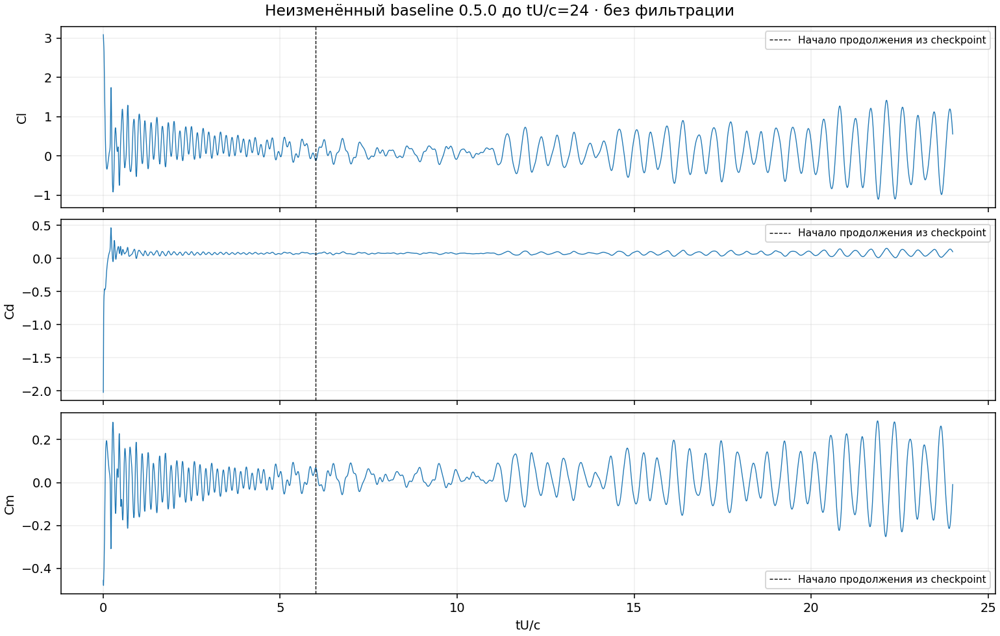
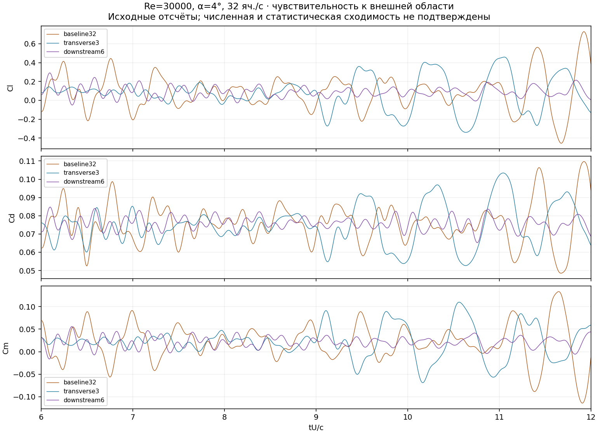
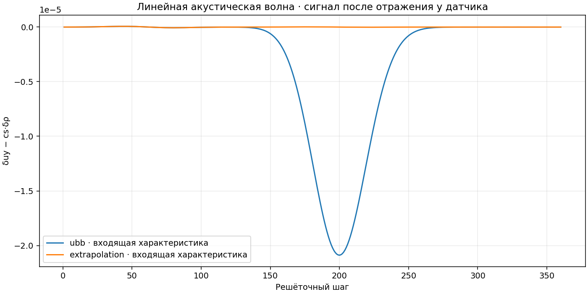

# Диагностика ядра и выпуск 0.5.1

Работы: 6–7 ноября 2026, UTC. Основание — первый этап
[дорожной карты](../ROADMAP_RU.md). Это исследование причин расхождения
с продувками и исправление воспроизводимых ошибок. Полная физическая
валидация ещё не завершена.

## Что установлено

1. Независимый пересчёт обмена импульсом на стенке подтверждает текущий
   учёт сил и момента в проверенных коротких задачах. Ошибка знака Cm
   в этих проверках не обнаружена; менять знак под эксперимент оснований нет.
2. Найден и исправлен дефект начального поля: перемещение точки момента
   перемещало начальное возмущение, хотя физическая постановка не менялась.
3. Найден и исправлен лишний шаг при округлении длительности. Например,
   `0.0175 / 0.0025 = 7.000000000000001` приводило к восьми шагам.
4. Добавлено продолжение завершённого или штатно остановленного CPU-расчёта
   в новую папку через API и CLI. Исходные результаты сохраняются.
5. Длительность исходного случая увеличена до tU/c=24. Пульсации не затухли.
   Изменение внешней области заметно меняет их величину.
6. Отдельный линейный волновой тест выявил сильное отражение от условия
   UBB на поперечной границе. Граничные условия обтекания пока сохранены:
   замена всей дальней границы на обычный выход не обоснована.

## Постановка и происхождение результатов

Длинный исходный расчёт, варианты области и аудит нагрузок выполнены
неизменённым установленным wheel **0.5.0**. Это сознательно сохранённая
базовая версия. Проверки исправлений выполняются установленным wheel
**0.5.1**. Свежий расчёт исправленной версии отделён от старой серии.
Планы записаны до получения соответствующих результатов:
[PLAN.json](PLAN.json), [DOMAIN_PLAN.json](DOMAIN_PLAN.json),
[ACOUSTIC_PLAN.json](ACOUSTIC_PLAN.json),
[REFERENCE_INVARIANCE_PLAN.json](REFERENCE_INVARIANCE_PLAN.json),
[CORRECTED_PLAN.json](CORRECTED_PLAN.json), [RESOURCE_PLAN.json](RESOURCE_PLAN.json).

Основной случай: одноэлементный NACA0012, конечная толщина задней кромки,
81 точка на сторону; Re=30000, α=4°, c=0.15 м, момент относительно c/4,
положительный Cm — на кабрирование. Геометрия повёрнута на −α, поток идёт
вдоль +x. Опорная площадь c×периодический размах; это участок крыла без концов.

Равномерная сетка: 32 яч./c, размах 0.5c и 16 ячеек, область 1.5c до тела,
3c после тела, поперечный запас 1.5c с каждой стороны. Полная сетка
176×101×16; Δx/c=1/32, ΔtU/c=0.00125. U_lattice=0.04,
ν_lattice=4.2666667e−5, сдвиговая частота релаксации ≈1.999488.
Решёточный Mach≈0.0693. ISA у земли даёт физическую скорость около
2.92 м/с и Mach≈0.00858; Kn порядка 4e−7. Это континуальный режим воздуха.

Метод: double precision D3Q27, кумулянтный оператор lbmpy/pystencils 1.4,
неподвижная стенка Bouzidi, вход и поперечные границы UBB, выход
ExtrapolationOutflow, периодический размах. Явная SGS выключена. Начальное
возмущение 0.0001 с seed=31 — численное возмущение, а не измеренный спектр
турбулентности трубы. Отсутствие SGS не подтверждает DNS.

Объёмная частота релаксации старого равномерного ядра равна 1. Её затухание
в общих единицах меняется при изменении сетки с постоянным U_lattice.
Это по-прежнему мешает трактовать прежнюю пару 32→64 как чистую сеточную
сходимость. Частоты столкновений в этом выпуске не подбирались под продувку.

Среда выполнения — Linux, CPython 3.12, NumPy 2.3.5, CPU. Квота исполнителя
составляет два ядра и 8 GiB RAM. Это другая машина, чем i9/128 ГБ пользователя;
GPU в этой среде не проверялся. Зависимости runtime не добавлены.

## Независимый аудит нагрузок и дискретных бюджетов

Инструмент: `tools/audit_uniform_loads.py`; данные:
[loads_audit/CHECKS.json](loads_audit/CHECKS.json).
Проверены α=0°, +4°, −4°, перенос точки момента и по 12 шагов.
Соседние пары жидкость–стенка перечислены по геометрии независимо от
индексных списков производственного расчёта нагрузки. Учитывается только
собственный периодический объём, без повторного счёта призрачных слоёв.

Допуски до проверки: абсолютная разность коэффициентов ≤2e−10;
ошибки бюджета массы/импульса на собственную жидкую ячейку ≤2e−12,
для углового момента — с дополнительной нормировкой на число ячеек хорды.
Максимальная разность нагрузок в основных случаях ≤6.22e−14,
максимальная нормированная ошибка бюджета ≤6.96e−16. Статус **passed**.

В бюджете явно учтены потоки через открытые границы и обмен массой при
интерполяции на стенке. Учтённый обмен массой со стенкой бывает ненулевым.
Закрытие такого бюджета подтверждает учёт источников и потоков;
оно само по себе не доказывает точную непроницаемость или достаточное
пристенное разрешение Bouzidi. Для последнего нужны отдельные проверки.

## Исправление зависимости начального поля от точки момента

Раньше координаты численного возмущения отсчитывались от точки момента.
Теперь они отсчитываются от передней кромки в вычислительной системе.
Точка приложения отчётного момента больше не меняет физический запуск.
У двухуровневого инициализатора эта система отсчёта уже использовалась.

Для α=4°, Re=30000, perturbation=0.002 сравнивались точки (0.25,0) и
(0.4,−0.03). Максимальная разность начальных скоростей уменьшилась
с **1.39518e−5** до **7.03e−20** в решёточных единицах. Ошибка независимого
закона переноса момента за 12 шагов уменьшилась с **3.56172e−7** до
**2.07168e−13**. Допуски 2e−14 для поля и 2e−10 для нагрузок не изменялись.
См. [до](reference_before.json), [после](reference_after.json).

Файл «после» получен первой сборкой 0.5.1 до исправления округления;
инициализатор в окончательном wheel тот же и проверяется регрессией повторно.
Новые запуски при ненулевом угле могут отличаться от старых траекторий.
Восстановленный checkpoint сохраняет свои поля: новая инициализация их
не заменяет. Этот дефект не объявляется единственной причиной расхождения
аэродинамических коэффициентов.

## Длительность и внешняя область

Продолжено исходное поле 0.5.0 от t*=6 до 24. Параметры, геометрия и
операторы сохранены; исходные файлы проверены по SHA-256.
История нового отрезка хранится отдельно. Средние по полуоткрытым окнам:

| Окно tU/c | Средний Cl | RMS Cl | Средний Cd | Средний Cm |
|---|---:|---:|---:|---:|
| [3,6) | 0.202859 | 0.178508 | 0.074446 | +0.016998 |
| [6,12) | 0.092435 | 0.188564 | 0.075839 | +0.019700 |
| [12,18) | 0.106181 | 0.381072 | 0.076466 | +0.022290 |
| [18,24) | 0.150290 | 0.625000 | 0.078051 | +0.015026 |

Смена частоты записи исходного и продолженного отрезков учтена: каждое
окно анализируется со своей равномерной выборкой. Последнее окно не
превращает серию в статистически установившуюся. RMS — пульсации,
не ошибка среднего; доверительный интервал не приписан.

Для трёх размеров области при неизменных Re, N32 и стенке, окно [6,12):

| Область | Средний Cl | RMS Cl | Средний Cd | Средний Cm |
|---|---:|---:|---:|---:|
| Исходная, выход 3c, поперечный запас 1.5c | 0.092435 | 0.188564 | 0.075839 | +0.019700 |
| Поперечный запас 3c | 0.076528 | 0.174188 | 0.074880 | +0.021653 |
| Выход 6c | 0.090316 | 0.056014 | 0.075824 | +0.021377 |

Удаление выхода уменьшило RMS Cl примерно на 70%, но близость средних
двух областей не подтверждает правильность обоих результатов. Изменение
поперечной области также меняет длину волны старого начального возмущения;
этот сопутствующий эффект сохранён в протоколе. При удалении только выхода
начальное поле на общей части области совпадает.

На конечном поле исходного грубого расчёта при t*=24 максимум |w|/U∞
составляет около 4.59e−14, разность скорости по размаху ≤1.26e−13 U∞.
Это практически однородное по размаху поле; данный случай не демонстрирует
разрешённую трёхмерную турбулентность. Проверка относится к одному полю,
а не ко всем возможным сеткам или режимам:
[SPAN_DIAGNOSTIC.json](SPAN_DIAGNOSTIC.json).

## Отражение волны на внешней границе

Независимая контрольная задача без профиля: область 8×256×8,
периодичность x/z, фон ux=0.04; гауссов импульс δρ=2e−5 и
δuy=cs·δρ движется вдоль +y. В обоих случаях одинаковы импульс,
частоты релаксации и положение датчика y=216.

Измерялись исходящая характеристика δuy+cs·δρ и входящая δuy−cs·δρ.
Окна до расчёта: шаги 20–130 для падающей волны, 140–330 для отражённой.
Отношение амплитуд у датчика, включая распространение и затухание:

| Верхняя граница | Отражённая/падающая амплитуда у датчика |
|---|---:|
| UBB свободного потока | 0.935864 |
| Диагностическая ExtrapolationOutflow, нормаль +y | 0.000824 |

Это характеристика данного линейного теста, а не универсальный коэффициент
отражения. Частотные пики истории сил сами по себе не устанавливают
причину колебаний. Обычный экстраполяционный выход не заменяет корректное
дальнее условие при смешанном втекании/вытекании и циркуляции около профиля.
Нужно вывести и верифицировать подходящее неотражающее условие, затем
повторить обтекание, бюджеты и чувствительность к области.

## Продолжение и совместимость

`continue_run` и команда `aerokinetic continue` создают новый временной
отрезок в новой папке. Время глобальное, история содержит новые отсчёты;
средние относятся к новому отрезку. Все физические/сеточные параметры,
частота записи и условия окончания сохраняются. Для совмещённой статистики
нужно явно собрать записи нескольких отрезков, учитывая частоту записи.

Проверяются отпечаток постановки, часы checkpoint, префиксы истории и
невязок. В `continuation.json` записываются SHA-256 шести исходных файлов,
начальное и целевое время. Продолжение не разрешает изменить Re или сетку.
Обычная команда `resume` по-прежнему восстанавливает прерванный отрезок
до его прежней цели и отклоняет уже завершённый отрезок.

Регрессии проверяют равномерную и сгущённую сетки, точное совпадение
распределений с непрерывным прогоном, остановку/возобновление дочернего
отрезка, неизменность родителя и отказ при повреждении истории.
Отдельно проверен checkpoint **0.5.0 → 0.5.1**: после семи дополнительных
шагов распределения и состояние выхода точно совпали со старым ядром
при ручном выполнении семи шагов.
[Доказательство](legacy_checkpoint/CHECKS.json).

Перевод длительности в число шагов теперь устраняет только округление
около целого в пределах четырёх ULP, с пределом 1e−8 шага. Содержательная
дробная добавка по-прежнему требует ещё одного шага; положительный запрос
короче шага выполняет один шаг. Используется одна функция в обоих решателях,
продолжении и индикаторе GUI. Старые checkpoint сохраняют прежнюю цель.

Кнопка продления завершённого расчёта в GUI пока не добавлена. Новый
сценарий доступен через CLI/API; подробный пример — в
[описании выпуска](../RELEASE_051_RU.md).

## Проверка окончательного wheel и упаковки

Wheel 0.5.1: SHA-256
`01f84482f4ca1f6fcf3882303709b4f89969010b27367880e25faff8e42a152e`.
Все файлы runtime совпали между исходниками, wheel и установленным пакетом:
[WHEEL_IDENTITY.json](WHEEL_IDENTITY.json). Версии окружения записаны там же.

Окончательная сборка прошла **29 основных тестов** за 920.47 с и
**9 тестов упаковки**. Это выбранные проверки затронутых контрактов,
а не заявление о повторном запуске всего исторического CFD-набора.
[JUnit ядра](tests_final_051.xml), [JUnit упаковки](tests_packaging_final.xml).
Применена команда `python -m pytest -q -o pythonpath=` с абсолютными
путями к выбранным тестам из `/tmp`, поэтому импорт шёл из installed wheel.

В отдельной чистой среде с пустым объектным/символьным JIT-кешем выполнены
расчёт, CLI-продление на семь шагов и GIF. Сокетные подключения и DNS Python
запрещены; попыток не было. Команда запускалась в стандартной сетево
ограниченной песочнице. Полная установка зависимостей использовала
`pip install --no-index` и локальные закреплённые wheels.
См. [cold_offline_final/CHECKS.json](cold_offline_final/CHECKS.json).

Самостоятельно замороженная Linux-программа перемещена в папку с пробелами
и кириллицей. Проверены хеши 1896 файлов, настоящая OpenMP-компиляция из
включённых заголовков, равномерная и двухуровневая сетки, точная история
после остановки/возобновления, кадры/CSV/PNG/GIF и экспериментальный каталог.
Начальная попытка выявила пропущенный модуль CLI; исправлен состав
PyInstaller-hook, полный контроль хешей сохранён. Повторная проверка прошла:
[frozen_linux/CHECK.json](frozen_linux/CHECK.json),
[отчёт сборщика](frozen_linux/BUILD_CHECK.json),
[причина повторной попытки](frozen_linux/RETRY.json).

Это Linux-проверка механизма упаковки. GUI не запускался: у исполнителя
нет дисплея/Xvfb. Windows/MSVC и целевой офлайн-ПК здесь не проверялись.
Linux-вариант использует местный g++; переносимый Windows-вариант
предусматривает копию установленного MSVC/SDK. Загрузка PyInstaller для
подготовки отдельной сборочной среды выполнялась отдельно от автономного
испытания; runtime-зависимости не менялись.

| Направление | Статус | Основание |
|---|---|---|
| Исправления и совместимость | passed | Регрессии обоих решателей и старого checkpoint |
| Учёт нагрузок/бюджетов | passed | Независимая проверка коротких задач; не точность стенки |
| Область и длительность | inconclusive | Чувствительность измерена, сходимость не достигнута |
| Сеточная/Mach/размаховая сходимость | not_run | Новая систематическая матрица ещё не выполнена |
| Cl/Cd/Cm по продувке | inconclusive | Большое расхождение, численная неопределённость не оценена |
| Установленный Linux CPU без сети | passed | Пустые кеши, расчёт/CLI/GIF |
| Упакованный Linux CPU | passed | Перенос папки и холодный self-test |
| Native Windows/MSVC, GUI/DPI, GPU | not_run | Нет соответствующего целевого испытания |

## Пилот ресурсов и потоков

На сетке 176×101×16 выполнены два последовательных процесса: 16 шагов
разогрева и 256 измеряемых шагов с обычными границами, нагрузками и
проверкой состояния каждые 8 шагов. Запись кадров/checkpoint и подготовка
в измеряемое время не включены. Конфигурация записана до опыта.

| Потоки | Первый пилот, млн ячеек/с | Повтор с сохранением поля | Пиковый RSS первого процесса |
|---|---:|---:|---:|
| 1 | 20.00 | 20.46 | 268.4 MiB |
| 2 | 16.56 | 16.76 | 265.9 MiB |

Ускорения на двух потоках в этой небольшой облачной задаче не получено.
Эти числа нельзя переносить на i9, другие сетки или GPU. RSS относится к
Python-процессу; это не измерение суммарного пика компилятора и всего ПК.
Одной сетки и двух запусков недостаточно для модели масштабирования.

Исходный строгий критерий **совпадения хешей при смене числа потоков
не пройден**: различаются также собственные жидкие узлы, а не только
служебные слои. Диагностический повтор показал максимум разности
распределений 6.32e−16, плотности 1.34e−15, скорости 5.83e−16 в решёточных
единицах. Разность итоговых коэффициентов ≤2.07e−14. При повторе с тем же
числом потоков хеши точно совпали для каждого варианта.

Масштаб различий соответствует округлению double, но источник по отдельным
скомпилированным ядрам здесь ещё не локализован. В конфигурации upstream
используется `g++ -Ofast ... -fopenmp`; побитовое равенство разных
скомпилированных вариантов таким контрактом не гарантируется. Критерий после неудачи
не заменялся новым допуском и не переименован в `passed`. Это отдельная
открытая проверка побитовой воспроизводимости, а не доказательство
неточности среднего профиля на уровне 1e−14 или аэродинамической точности.
См. [RESOURCE_CHECK.json](RESOURCE_CHECK.json) и файлы `profile_*.json`.

## Эксперимент и границы вывода

Эталон: Ohtake, Nakae, Motohashi (2007), DOI
[10.2322/jjsass.55.439](https://doi.org/10.2322/jjsass.55.439), Re=30000.
Cl — рис.5, Cd — рис.6, Cm — рис.11. При α=4° линейная интерполяция
оцифрованных измерений даёт Cl≈0.308739, Cd≈0.0445094, Cm(c/4)≈−0.0205327.
Происхождение и графическая неопределённость сохранены в
[предыдущем отчёте](../verification_naca0012_20261106/REPORT_RU.md).
Неизвестные условия перехода/турбулентности и различия разрешения не исчезают
при переносе этих чисел в новую таблицу. Данные других CFD не использованы.

Свежий установленный 0.5.1 завершил 9600 шагов до t*=12. По независимому
пересчёту истории в окне 6…12 получено:

| Коэффициент | Продувка при 4°, интерполяция | 0.5.1, N32 | Разность |
|---|---:|---:|---:|
| Cl | 0.308739 | 0.092435 | −0.216304 |
| Cd | 0.044509 | 0.075839 | +0.031330 |
| Cm(c/4) | −0.020533 | +0.019700 | +0.040232 |

Cd выше оцифрованного опыта на 70.39%. Это другое окно и более грубая
сетка, чем прежние +22.06% на N64 в окне 3…6; разность процентов не означает
ухудшения одного и того же сошедшегося результата. Новые средние отличаются
от 0.5.0 в том же окне 6…12 максимум на 4.44e−11. Следовательно, исправление
возмущения не объясняет расхождение данной контрольной точки.

Результат и независимый пересчёт по CSV:
[corrected32_t12/summary.json](corrected32_t12/summary.json),
[corrected_comparison/COMPARISON.json](corrected_comparison/COMPARISON.json).
Итоги проверки сборки и испытаний — в [CHECKS.json](CHECKS.json) этого отчёта.

**Этап диагностики продвинут, но не закрыт.** Причины расхождений разделены
частично; сеточная/статистическая сходимость, стенка, дальнее условие и
трёхмерное разрешение требуют дальнейшей работы. Диапазон выпущенного
ядра остаётся Re=10⁴…10⁵, Mphysical≤0.15. Расчёт Re≈6 млн с механизацией
и доказанная точность высокого Re пока не реализованы.

Поставка остаётся исследовательской. Linux CPU, Windows/MSVC, GUI/DPI и
GPU имеют раздельные статусы; наличие сценария Windows-сборки не заменяет
его выполнение на целевом компьютере.
